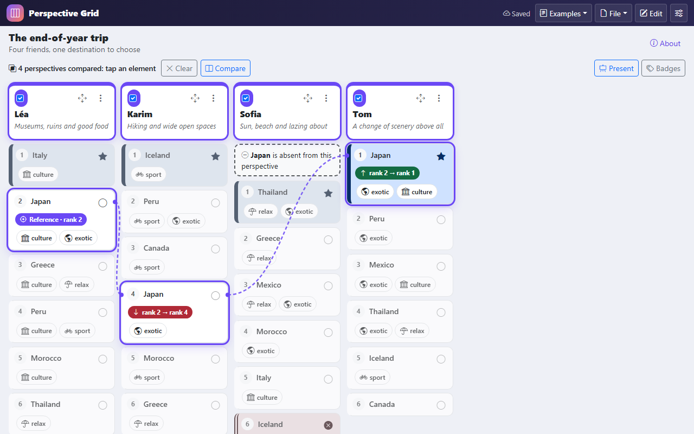
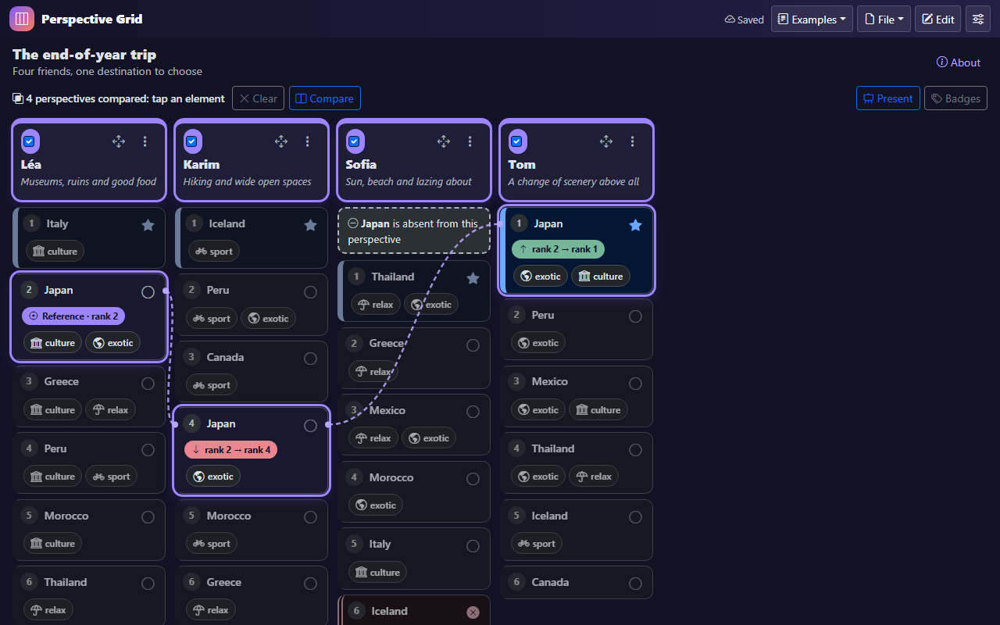
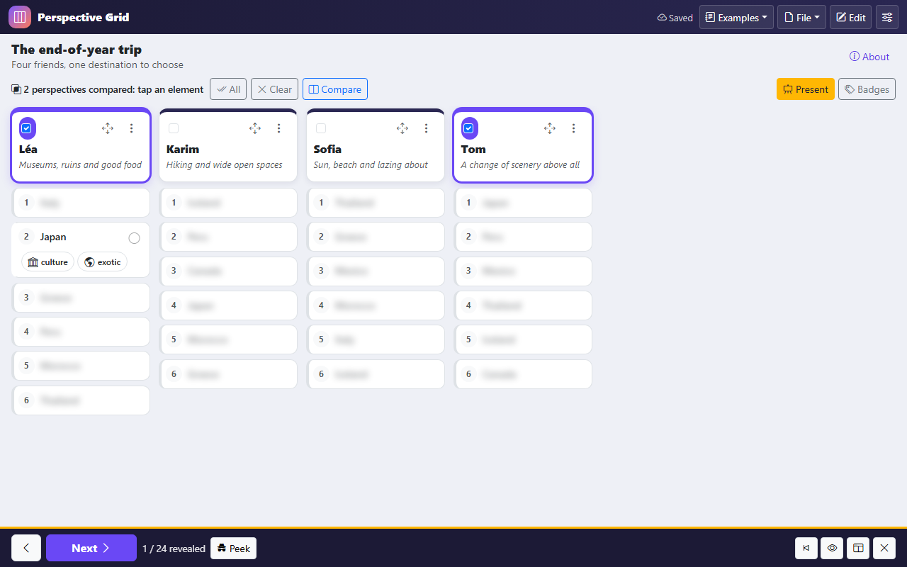

# Perspective Grid (`perspective-grid`)

**▶ Try it: [edu-fpar.github.io/perspective-grid](https://edu-fpar.github.io/perspective-grid/)** &nbsp;·&nbsp; [Example in English](https://edu-fpar.github.io/perspective-grid/?src=https://edu-fpar.github.io/perspective-grid/visuels/en/end-of-year-trip.md)

*[Version française](README.md)* · *[Versión en español](README.es.md)*

[](https://doi.org/10.5281/zenodo.24508193)
Source code: [github.com/edu-fpar/perspective-grid](https://github.com/edu-fpar/perspective-grid)



A teaching tool that shows **how several points of view rank the same set of items differently**:
schools of thought, theories, actors, periods, cultures… Each point of view is a column; its items are
ranked from most to least important; you compare ranks, absences and positions (central, rejected,
ignored…).

A static web app, 100 % in the browser, with no build step: Bootstrap 5.3, Bootstrap Icons, marked,
plain JavaScript, `localStorage`. The interface is available in **English, French and Spanish** (Settings ›
Interface language, or `?lang=en` / `?lang=fr` / `?lang=es` in the address); grids can be written in any language.

[Documentation](https://edu-fpar.github.io/perspective-grid/docs/?lang=en) &nbsp;·&nbsp; [Page for AIs](docs/skill-en.md) &nbsp;·&nbsp; [File format](docs/FORMAT.md)

## Build a grid with an AI

No need to learn the syntax. Give any AI (ChatGPT, Claude, Gemini, Mistral, Copilot…) the address of the
instructions page and your content:

> Read the instructions at https://edu-fpar.github.io/perspective-grid/docs/skill-en.md. Tell me whether the
> following course lends itself to a "Perspective Grid" and, if so, produce the file. Audience: first-year
> students, 4 to 6 points of view. [paste your course, outline or notes here]

The AI first says whether the tool fits, then gives a Markdown block to paste into the app
(*File › Paste Markdown*, or Ctrl+V on the page). French version: [docs/skill.md](docs/skill.md).
The [`llms.txt`](llms.txt) file at the root points AIs to these pages.



## Getting started

**Online**: open the link above. Ready-made examples (content in French):
[schools of teaching](https://edu-fpar.github.io/perspective-grid/?ex=courants-pedagogiques) ·
[ethics and AI](https://edu-fpar.github.io/perspective-grid/?ex=ethiques-ia) ·
[end-of-year trip](https://edu-fpar.github.io/perspective-grid/?ex=voyage-fin-d-annee) (the simplest way to discover the tool) ·
[ethics and AI, from scratch, item by item](https://edu-fpar.github.io/perspective-grid/?ex=ethiques-ia&stage=zero&spot=1&order=element).
The trip example also exists [in English](https://edu-fpar.github.io/perspective-grid/?src=https://edu-fpar.github.io/perspective-grid/visuels/en/end-of-year-trip.md)
([file](visuels/en/end-of-year-trip.md)).

**Locally, with Firefox**: open the developer tools and add the project folder: Firefox then serves the
files like a web server. Nothing to install.

**Locally, fallback**: any static web server, for example Python:

```bash
python -m http.server 8771 --bind 127.0.0.1
```

Then open <http://127.0.0.1:8771/>. The app also works from UwAmp/Apache or any static hosting. Opened
directly from disk (`file://`), everything works except loading an online file (`?src=`).

**Publish your own copy**: fork the repository and enable GitHub Pages (branch `main`, root folder).

## Usage

| I want to… | How |
|---|---|
| Compare two points of view | Tick "Compare" on 2 headers (or tap the header), then tap an item: ranks, gaps ↑↓, absences, connecting lines. |
| Compare on a phone | Select 2 columns then **Compare**: compact side-by-side view. |
| Annotate live | State button on the cell (6 states + badges) or keys **1–6**. **Badges** drawer: drag a badge onto a cell, or tap a badge then the cells. |
| Move a column | ← → arrows in the header, ✥ handle (drag and drop), or **Alt+←/→**. |
| Edit the grid | **Edit** (E key): double-click a text, handle to reorder (long press on mobile, **Alt+↑/↓** on the keyboard), **+** between two cells, pencil for the full form. |
| Load a file | File › Open, drop a `.md` on the page, or paste Markdown (Ctrl+V): preview + warnings before replacing. |
| Export | File › Export: new version (`version` +1, `based_on`, `updated`), new file name, the original is never overwritten. |
| Go back | Ctrl+Z in the session; File › Version history for saved versions (automatic backup before each replacement). |
| Share | File › Share link: self-contained link (`#z=`, grid compressed in the URL) or link to an online file (`?src=`). |

### Present without overloading (**Present** menu)

| Mode | Effect |
|---|---|
| **Spotlight** | Only one active column, the others are greyed out (clicking a greyed column puts it in the spotlight). In the column, the open item stands out and the others fade. |
| **Reveal › Progressive** | Items stay blurred and without state colour until you touch them. |
| **Reveal › From scratch** | Only the first header and the shape of the cards are visible; you reveal on click or with **Next**. |



The **Next** button follows the chosen order: column by column, rank by rank (all the no. 1s, then the
no. 2s…) or item by item (the same item appears in every column at once; "Spotlight" then highlights this
"row"). Presentation remote: **Page Down / Page Up** (or N / P). **Peek** discreetly shows the next step;
the **presenter window** (to keep on the computer screen while the grid is projected) shows the whole
sequence, the next step with its notes (details, states, badges) and drives the projection. These modes
never change the file.

### URL parameters

| Parameter | Effect |
|---|---|
| `?src=https://…/grid.md` | Loads an online file (same site, or a site allowing CORS: GitHub "Raw"…). |
| `?lang=en` / `?lang=fr` / `?lang=es` | Interface language (takes priority over the saved choice and the browser language). |
| `#z=…` | Full grid compressed in the link (generated by the app). |
| `?ex=courants-pedagogiques` / `?ex=ethiques-ia` / `?ex=voyage-fin-d-annee` | Opens an example. |
| `&cols=id1,id2` | Preselects columns for the comparison. |
| `&compact=1` | Opens the compact comparison view directly. |
| `&spot=1` | Opens in "Spotlight" mode. |
| `&stage=veil` / `&stage=zero` | Opens in progressive reveal / from scratch. |
| `&order=column` / `rank` / `element` | Order of the "Next" button. |

## File format

Full specification (single source of truth for the app and the skills): [`docs/FORMAT.md`](docs/FORMAT.md).

```markdown
---
format: perspective-grid/v1
title: Schools of teaching
lang: en
version: 1
based_on: null
updated: 2026-11-11
---

# Elements

## [error] The role of error
Default description.

# Perspectives

## Behaviourism {#behaviourism}
subtitle: Skinner, Watson
> Short description.

### [reinforcement] Reinforcement
state: primary
badges: central
Detail specific to this point of view.

### [error]
state: danger
badges: rejected
```

### Column width

By default, columns are sized for cards with text. For very short cards (a country name, a word), add
`columns: narrow` to the file header, or choose "Narrow" in Edit › Title and introduction: columns are tighter,
and two fit on a phone screen. `columns: wide` gives wider columns.

## Skills for Claude Code (developers)

For any AI, the [instructions page](docs/skill-en.md) is enough. The two skills below are for Claude Code
and work in the repository (automatic validation with the parser):

| Skill | Role |
|---|---|
| [`skills/perspective-grid-detect`](skills/perspective-grid-detect/SKILL.md) | Finds the passages of a course where a grid is relevant, and says when it is not. |
| [`skills/perspective-grid-format`](skills/perspective-grid-format/SKILL.md) | Produces a file that complies with `docs/FORMAT.md`, then validates it with the parser. |

To use them with Claude Code, copy both folders into `.claude/skills/` (project) or `~/.claude/skills/`
(user).

## Development

```bash
npm test                      # format tests (Markdown ↔ model round trip), Node 18+
node tools/validate.js f.md   # validate a file (--fix: rewrite in canonical form)
node tools/build-samples.js   # regenerate js/core/samples.js after editing examples/*.md
```

```
index.html            app (viewing + editing)
css/app.css           styles (mobile-first, light/dark themes, accessible states)
js/core/format.js     parser, serializer, validator (browser + Node)
js/core/pg.js         utilities, safe storage, compressed links, sanitized Markdown
js/core/i18n.js       all interface labels (fr, en, es)
js/core/samples.js    built-in examples (generated)
js/app/grid.js        rendering, comparison, keyboard navigation, columns
js/app/edit.js        edit mode, forms, cell drag and drop
js/app/io.js          import / preview, versioned export, sharing, history
js/app/stage.js       presentation modes, presenter window
js/app/app.js         state, autosave, toolbar, settings, badges
examples/             example grids (.md)
docs/index.html       documentation (FR / EN)
docs/skill.md         instructions for AIs (FR); skill-en.md (EN)
docs/FORMAT.md        format specification
docs/images/          screenshots (FR)
visuels/<lang>/       screenshots and examples by language (en, es)
skills/               detect and format skills
tests/                node:test tests
tools/                validate.js, build-samples.js
```

## License and citation

© 2026 François Parlant — [CC BY-NC-SA 4.0](https://creativecommons.org/licenses/by-nc-sa/4.0/). Using it in class or in training is free, with credit to the author; adaptations must be shared under the same license. See [LICENSE](LICENSE).

**Commercial use** (training company, publisher, white label, custom scenarios, tailored SCORM packages): a commercial license is available by agreement. [Get in touch](https://edu-fpar.github.io/about.html?lang=en).

**How to cite** (GitHub's *Cite this repository* button, from [CITATION.cff](CITATION.cff)):

> Parlant, F. (2026). *Perspective Grid (Regards croisés)* [Educational software]. Zenodo. https://doi.org/10.5281/zenodo.24508193

Using it in class? [Let me know](https://www.linkedin.com/in/francois-parlant/): this feedback helps me improve the tool and spread the word.
