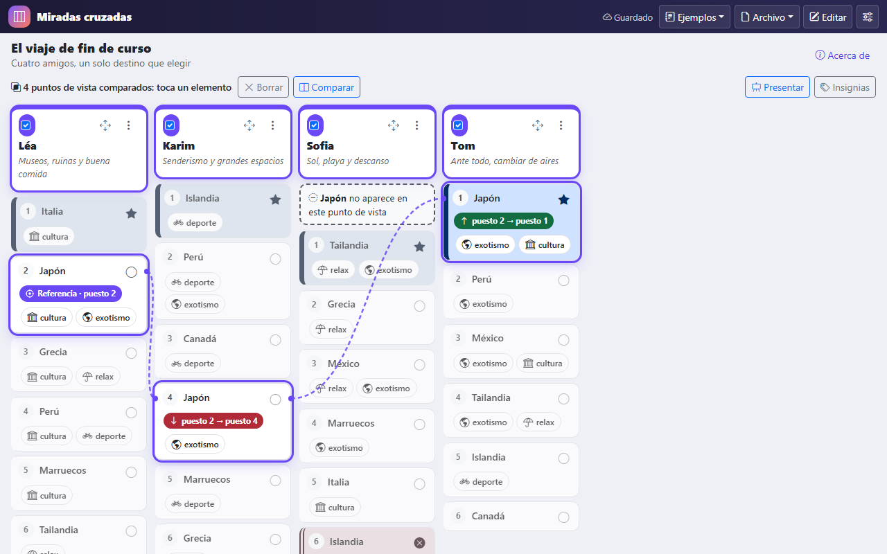
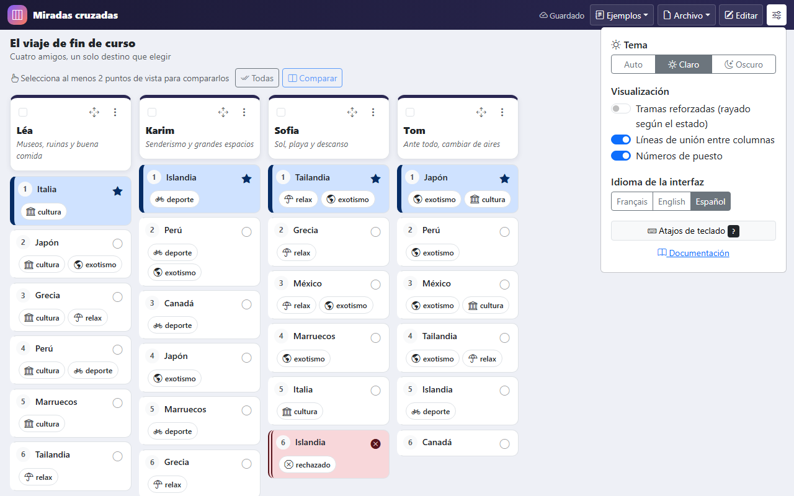
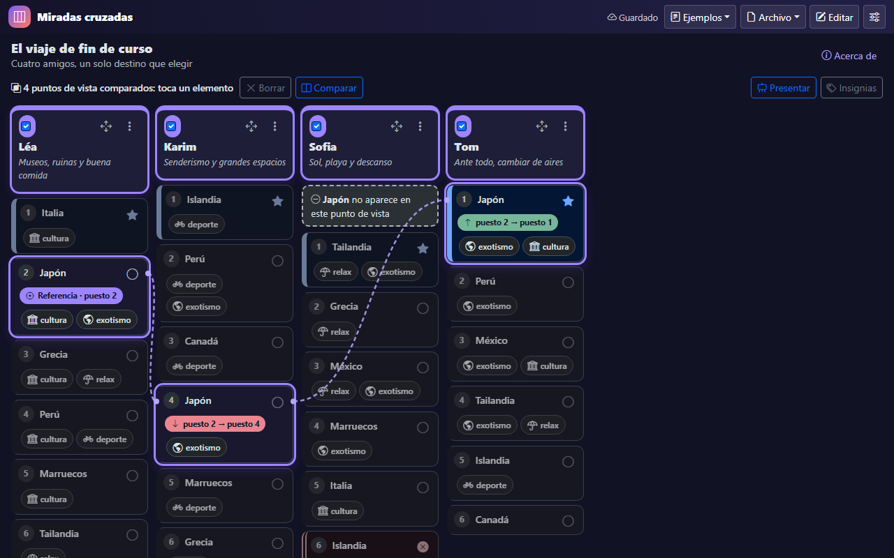
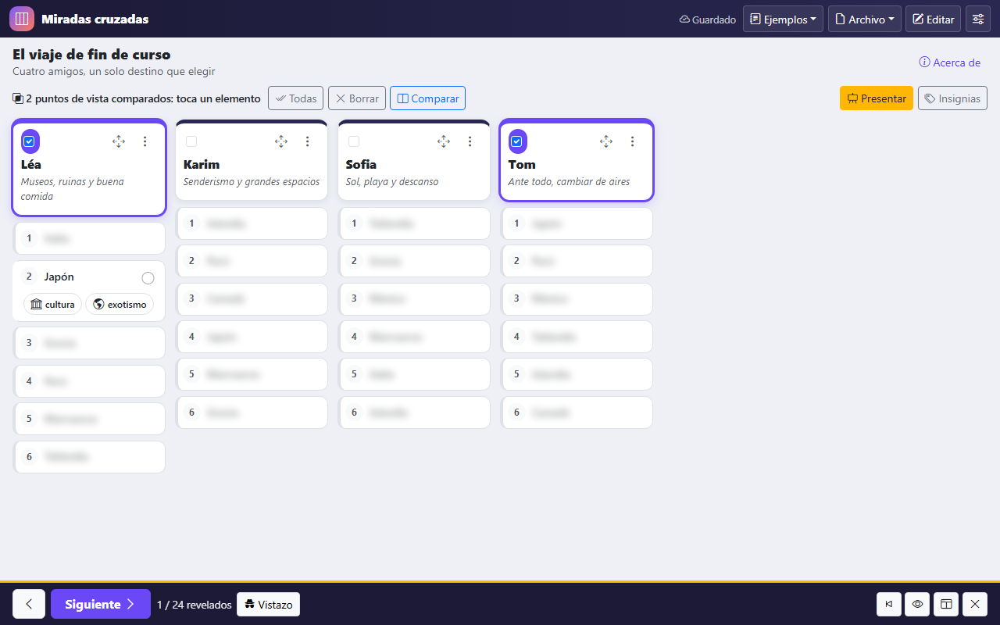

# Miradas cruzadas (`perspective-grid`)

**▶ Probar: [edu-fpar.github.io/perspective-grid](https://edu-fpar.github.io/perspective-grid/)** &nbsp;·&nbsp; [Ejemplo en español](https://edu-fpar.github.io/perspective-grid/?src=https://edu-fpar.github.io/perspective-grid/visuels/es/viaje-fin-de-curso.md)

*[Version française](README.md)* · *[English version](README.en.md)*

[](https://doi.org/10.5281/zenodo.24508193)
Código fuente: [github.com/edu-fpar/perspective-grid](https://github.com/edu-fpar/perspective-grid)



Herramienta didáctica que muestra **cómo varios puntos de vista jerarquizan de forma distinta un mismo
conjunto de elementos**: corrientes, teorías, actores, épocas, culturas… Cada punto de vista es una
columna; sus elementos se ordenan del más al menos importante; se comparan los puestos, las ausencias y las
posiciones (central, rechazado, ignorado…).

Aplicación web estática, 100 % en el navegador, sin compilación: Bootstrap 5.3, Bootstrap Icons, marked,
JavaScript sin framework, `localStorage`.

La interfaz está en **español, francés e inglés**: Ajustes › Idioma de la interfaz, o `?lang=es` en la
dirección (por ejemplo [edu-fpar.github.io/perspective-grid/?lang=es](https://edu-fpar.github.io/perspective-grid/?lang=es)).
Las cuadrículas se pueden escribir en cualquier idioma, como el [ejemplo en español](visuels/es/viaje-fin-de-curso.md).



[Documentación (en inglés)](https://edu-fpar.github.io/perspective-grid/docs/?lang=en) &nbsp;·&nbsp; [Página para las IA](docs/skill-en.md) &nbsp;·&nbsp; [Formato de archivo](docs/FORMAT.md)

## Crear una cuadrícula con una IA

No hace falta aprender la sintaxis. Da a cualquier IA (ChatGPT, Claude, Gemini, Mistral, Copilot…) la
dirección de la página de instrucciones y tu contenido:

> Lee las instrucciones de https://edu-fpar.github.io/perspective-grid/docs/skill-en.md. Dime si el curso
> siguiente se presta a una cuadrícula «Perspective Grid» y, si es así, genera el archivo en español.
> Público: estudiantes de primer año, de 4 a 6 puntos de vista. [pega aquí tu curso, tu esquema o tus notas]

La IA dice primero si la herramienta es adecuada y luego da un bloque de Markdown para pegar en la
aplicación (*Archivo › Pegar Markdown…*, o Ctrl+V en la página). Las instrucciones existen en inglés
([docs/skill-en.md](docs/skill-en.md)) y en francés ([docs/skill.md](docs/skill.md)). El archivo
[`llms.txt`](llms.txt) de la raíz indica estas páginas a las IA.



## Empezar

**En línea**: abre el enlace de arriba. Ejemplos listos para usar (en francés):
[corrientes pedagógicas](https://edu-fpar.github.io/perspective-grid/?ex=courants-pedagogiques) ·
[ética e IA](https://edu-fpar.github.io/perspective-grid/?ex=ethiques-ia) ·
[viaje de fin de curso](https://edu-fpar.github.io/perspective-grid/?ex=voyage-fin-d-annee) (el más sencillo para descubrir la herramienta).
El viaje de fin de curso también está [en español](https://edu-fpar.github.io/perspective-grid/?src=https://edu-fpar.github.io/perspective-grid/visuels/es/viaje-fin-de-curso.md)
([archivo](visuels/es/viaje-fin-de-curso.md)).

**En local, con Firefox**: abre las herramientas de desarrollo y añade la carpeta del proyecto: Firefox
sirve entonces los archivos como un servidor web. No hay nada que instalar.

**En local, alternativa**: cualquier servidor web estático, por ejemplo Python:

```bash
python -m http.server 8771 --bind 127.0.0.1
```

Luego abre <http://127.0.0.1:8771/>. La aplicación también funciona desde UwAmp/Apache o cualquier
alojamiento estático. Abierta directamente desde el disco (`file://`), todo funciona salvo la carga de un
archivo en línea (`?src=`).

**Publicar tu propia copia**: haz un fork del repositorio y activa GitHub Pages (rama `main`, carpeta raíz).

## Uso

| Quiero… | Cómo |
|---|---|
| Comparar dos puntos de vista | Marcar «Comparar» en 2 encabezados (o tocar el encabezado) y luego tocar un elemento: puestos, diferencias ↑↓, ausencias, líneas de unión. |
| Comparar en el móvil | Seleccionar 2 columnas y luego **Comparar**: vista compacta lado a lado. |
| Anotar en directo | Botón de estado en la celda (6 estados + insignias) o teclas **1–6**. Cajón **Insignias**: arrastrar una insignia a una celda, o tocar una insignia y luego las celdas. |
| Mover una columna | Flechas ← → del encabezado, asa ✥ (arrastrar y soltar) o **Alt+←/→**. |
| Modificar la cuadrícula | **Editar** (tecla E): doble clic en un texto, asa para reordenar (pulsación larga en el móvil, **Alt+↑/↓** con el teclado), **+** entre dos celdas, lápiz para el formulario completo. |
| Cargar un archivo | Archivo › Abrir un archivo .md…, arrastrar un `.md` a la página o pegar Markdown (Ctrl+V): vista previa y avisos antes de reemplazar. |
| Exportar | Archivo › Exportar en Markdown…: nueva versión (`version` +1, `based_on`, `updated`), nuevo nombre de archivo; el original nunca se sobrescribe. |
| Deshacer | Ctrl+Z durante la sesión; Archivo › Historial de versiones para las versiones guardadas (copia automática antes de cada reemplazo). |
| Compartir | Archivo › Enlace para compartir…: enlace autónomo (`#z=`, cuadrícula comprimida en la URL) o enlace a un archivo en línea (`?src=`). |

### Presentar sin sobrecargar (menú **Presentar**)

| Modo | Efecto |
|---|---|
| **Destacado** | Una sola columna activa, las demás en gris (un clic en una columna gris la destaca). En la columna, el elemento abierto resalta y los demás se atenúan. |
| **Revelado › Progresivo** | Los elementos quedan borrosos y sin color de estado hasta que se tocan. |
| **Revelado › Desde cero** | Solo se ven el primer encabezado y la forma de las tarjetas; se revela con un clic o con **Siguiente**. |



El botón **Siguiente** sigue el orden elegido: columna por columna, puesto por puesto (todos los n.º 1, luego
los n.º 2…) o elemento por elemento (un mismo elemento aparece en todas las columnas a la vez; «Destacado»
resalta entonces esa «fila»). Mando de presentación: **Av Pág / Re Pág** (o N / P). **Vistazo** muestra
discretamente el paso siguiente; la **ventana del presentador** (para la pantalla del ordenador mientras
se proyecta la cuadrícula) muestra todo el desarrollo, el paso siguiente con sus notas (detalles, estados,
insignias) y controla la proyección. Estos modos nunca modifican el archivo.

### Parámetros de URL

| Parámetro | Efecto |
|---|---|
| `?src=https://…/cuadricula.md` | Carga un archivo en línea (mismo sitio, o sitio que permita CORS: GitHub «Raw»…). |
| `?lang=es` / `?lang=en` / `?lang=fr` | Idioma de la interfaz (prioritario sobre la elección guardada y el idioma del navegador). |
| `#z=…` | Cuadrícula completa comprimida en el enlace (generado por la aplicación). |
| `?ex=courants-pedagogiques` / `?ex=ethiques-ia` / `?ex=voyage-fin-d-annee` | Abre un ejemplo. |
| `&cols=id1,id2` | Preselecciona columnas para la comparación. |
| `&compact=1` | Abre directamente la vista de comparación compacta. |
| `&spot=1` | Abre en modo «Destacado». |
| `&stage=veil` / `&stage=zero` | Abre en revelado progresivo / desde cero. |
| `&order=column` / `rank` / `element` | Orden del botón «Siguiente». |

## Formato de archivo

Especificación completa (en inglés, fuente única para la aplicación y las skills):
[`docs/FORMAT.md`](docs/FORMAT.md).

```markdown
---
format: perspective-grid/v1
title: Las corrientes pedagógicas
lang: es
version: 1
based_on: null
updated: 2026-11-11
---

# Elements

## [error] El papel del error
Descripción por defecto.

# Perspectives

## Conductismo {#conductismo}
subtitle: Skinner, Watson
> Descripción breve.

### [refuerzo] El refuerzo
state: primary
badges: central
Detalle propio de este punto de vista.

### [error]
state: danger
badges: rejected
```

Las palabras clave del formato (`# Elements`, `# Perspectives`, `state:`, `badges:`…) no se traducen.

### Ancho de las columnas

Por defecto, las columnas tienen un ancho pensado para tarjetas con texto. Para tarjetas muy cortas (el
nombre de un país, una palabra), añade `columns: narrow` en el encabezado del archivo o elige «Estrechas» en
Editar › Título e introducción: las columnas son más estrechas y caben dos en la pantalla de un móvil.
`columns: wide` da columnas más anchas.

## Skills para Claude Code (desarrolladores)

Para cualquier IA basta con la [página de instrucciones](docs/skill-en.md). Las dos skills siguientes son
para Claude Code y trabajan en el repositorio (validación automática con el analizador):

| Skill | Función |
|---|---|
| [`skills/perspective-grid-detect`](skills/perspective-grid-detect/SKILL.md) | Localiza en un curso los pasajes donde una cuadrícula es pertinente, y dice cuándo no lo es. |
| [`skills/perspective-grid-format`](skills/perspective-grid-format/SKILL.md) | Genera un archivo conforme a `docs/FORMAT.md` y lo valida con el analizador. |

Para usarlas con Claude Code, copia las dos carpetas en `.claude/skills/` (proyecto) o `~/.claude/skills/`
(usuario).

## Desarrollo

```bash
npm test                      # pruebas del formato (ida y vuelta Markdown ↔ modelo), Node 18+
node tools/validate.js f.md   # validar un archivo (--fix: reescribir en forma canónica)
node tools/build-samples.js   # regenerar js/core/samples.js tras modificar examples/*.md
```

```
index.html            aplicación (consulta + edición)
css/app.css           estilos (mobile-first, temas claro/oscuro, estados accesibles)
js/core/format.js     analizador, serializador, validador (navegador + Node)
js/core/pg.js         utilidades, almacenamiento seguro, enlaces comprimidos, Markdown saneado
js/core/i18n.js       todos los textos de la interfaz (fr, en, es)
js/core/samples.js    ejemplos integrados (generado)
js/app/grid.js        renderizado, comparación, navegación con teclado, columnas
js/app/edit.js        modo edición, formularios, arrastrar y soltar celdas
js/app/io.js          importación / vista previa, exportación con versiones, compartir, historial
js/app/stage.js       modos de presentación, ventana del presentador
js/app/app.js         estado, guardado automático, barra de herramientas, ajustes, insignias
examples/             cuadrículas de ejemplo (.md)
docs/index.html       documentación (FR / EN)
docs/skill.md         instrucciones para las IA (FR); skill-en.md (EN)
docs/FORMAT.md        especificación del formato
docs/images/          capturas de pantalla (FR)
visuels/<idioma>/     capturas y ejemplos por idioma (en, es)
skills/               skills detect y format
tests/                pruebas node:test
tools/                validate.js, build-samples.js
```

## Licencia y cita

© 2026 François Parlant — [CC BY-NC-SA 4.0](https://creativecommons.org/licenses/by-nc-sa/4.0/deed.es). El uso en clase y en formación es libre, citando al autor; tus adaptaciones se comparten con la misma licencia. Ver [LICENSE](LICENSE).

**Uso comercial** (empresa de formación, editorial, marca blanca, escenarios a medida, paquetes SCORM personalizados): es posible una licencia comercial previo acuerdo. [Contactar](https://edu-fpar.github.io/about.html).

**Citar esta herramienta** (botón *Cite this repository* de GitHub, a partir de [CITATION.cff](CITATION.cff)):

> Parlant, F. (2026). *Perspective Grid (Regards croisés)* [Software educativo]. Zenodo. https://doi.org/10.5281/zenodo.24508193

¿La usas en clase? [Cuéntamelo](https://www.linkedin.com/in/francois-parlant/): estos comentarios me ayudan a mejorar la herramienta y a darla a conocer.
